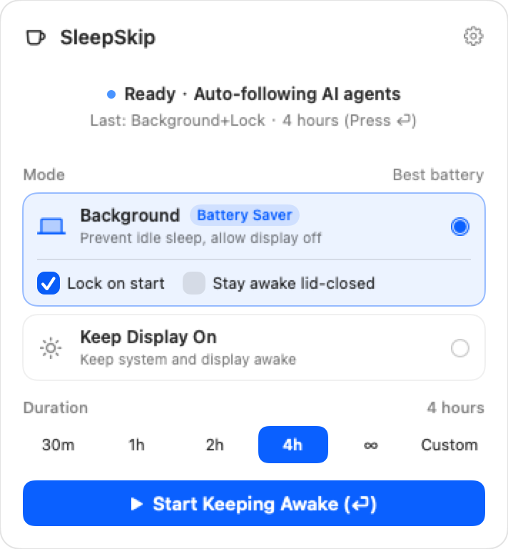
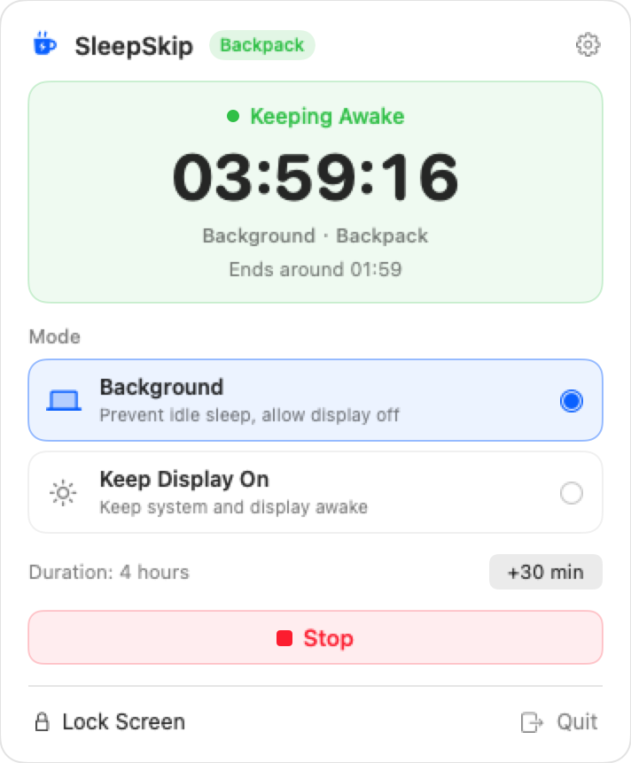
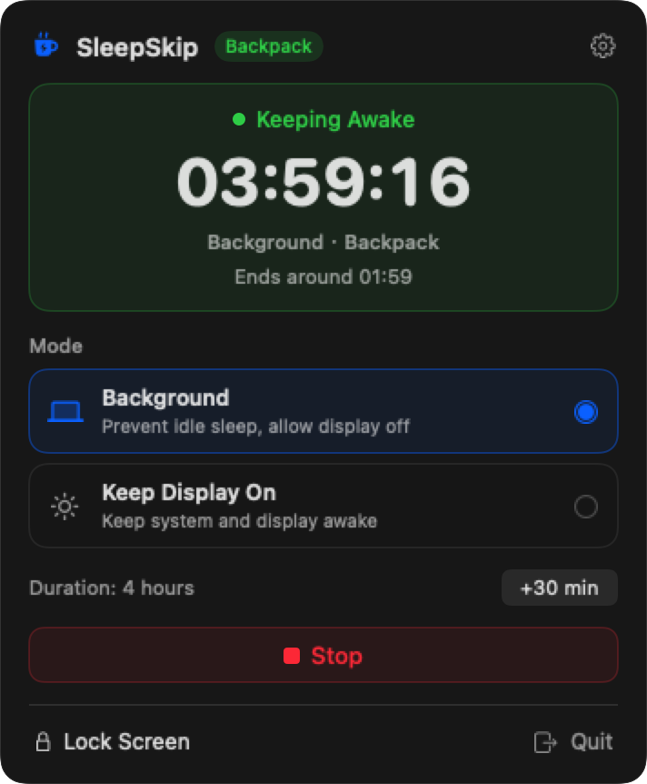
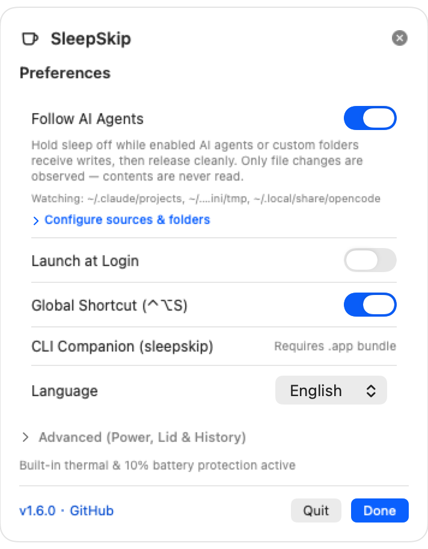

# SleepSkip · 惜眠

**Keep your Mac awake around your agent workflows.**

A native macOS menu bar & CLI keep-awake utility. Directory following uses recent transcript writes from Claude Code, Codex, Gemini CLI, OpenCode, or DeepSeek Harness as an activity signal. Explicit hooks and wrapped commands provide lifecycle signals for workflows that need them.

[中文文档](README_CN.md) · [Changelog](CHANGELOG.md) · [Product Spec (PRD)](docs/PRD.md) · [Measured Resource Usage](docs/PERFORMANCE.md) · [Contributing](CONTRIBUTING.md)

## 30-Second Quickstart

```bash
# Install SleepSkip.app + sleepskip CLI via Homebrew
brew install --cask laiyongqiang/tap/sleepskip

# Or wrap a terminal agent / build command directly
sleepskip -- codex "refactor auth module"
```

Open SleepSkip from the menu bar to start with one `Enter` keystroke, or leave **Auto-Follow Agents** enabled so it holds sleep automatically whenever your agents are writing. (Manual release downloads can also install the `sleepskip` CLI in one click inside **Preferences**.)

Directory following is a heuristic: a write counts as active for 30 seconds, followed by a 5-minute grace period (extended when an observed agent subprocess is still running). Each automatic run has a configurable safety ceiling (2 hours by default; adjustable to `2h`, `4h`, `8h`, `12h`, or `Unlimited` in Preferences). Manual timers can also hand off automatically to Auto-Follow on expiry when an agent is still active. Use a wrapped command or an explicit manual session for work whose exact duration must be guaranteed without transcript signals.

See [beta scope and acceptance](docs/BETA.md) for supported evidence, known limitations, and recovery steps. Closed-lid modes remain experimental until verified on your hardware and macOS version.

---

## Preview

| Idle (Light) | Active Countdown (Light) | Active Countdown (Dark) | Preferences |
| :---: | :---: | :---: | :---: |
|  |  |  |  |

---

## Why SleepSkip?

Traditional keep-awake tools were designed a decade ago to keep screens lit while reading or presenting. In the AI Agent era, most workflows run headless in the background while the screen is off, the computer is locked, or the machine is running on battery.

SleepSkip is built around first principles:
- **Auto-follow agents & custom folders** (on by default): watches the transcript folders of Claude Code, Codex, Gemini CLI, OpenCode, DeepSeek Harness, plus any custom folders you add in Preferences (with per-source toggles), holding sleep off while they write and releasing cleanly after a 5-minute grace period (or extending while a detected agent subprocess stays active). Historical measurements and their tested versions are recorded in [Measured Resource Usage](docs/PERFORMANCE.md). Process polling was measured at ~160 ms/30 s plus one wakeup per second, and rejected. Only file changes are observed; transcript contents are never read. A manual session always wins (with one-click promotion from Auto-Follow, optional automatic handoff back to Auto-Follow on timer expiry, and one-click return to Auto-Follow), while a configurable safety ceiling (default 2 hours) prevents an accidental all-nighter. Stopping an active auto-follow session releases the current run until the next quiet cycle without turning off the global setting.
- **Event-driven monitoring and a visible-only countdown**: Powered directly by macOS native `/usr/bin/caffeinate`. The 1Hz countdown timer exists **only** while the popover is open. Directory following schedules one-shot activity deadlines; the experimental standard closed-lid mode also re-arms its flag every 5 seconds while active. [Measured](docs/PERFORMANCE.md): 0.09–0.24 ms of CPU per 120 s idle — the same order as a menu bar app that does nothing but draw its icon.
- **Bound assertion lifetime**: GUI and CLI assertions watch their owning SleepSkip process with `caffeinate -w <PID>`. Normal completion and cancellation release them; privileged closed-lid cleanup additionally relies on its sentinel and restoration script.
- **Event-Driven Global Shortcut (`⌃⌥S`) & One-Keystroke Launch**: Toggle keep-awake from anywhere via Carbon `RegisterEventHotKey` (`⌃⌥S`, no Accessibility prompt and no shortcut polling, toggleable in Preferences), or open the popover and hit `Enter` to start with your remembered config.
- **CLI Companion (`sleepskip -- <cmd>`, `status`, `hook`)**: Wrap terminal agents or build commands while preserving terminal input and child exit status, inspect the running menu bar app's state via `sleepskip status --json` (transition-only snapshot, zero IPC polling), control sessions with `sleepskip stop` / `toggle` / `lock`, or wire instant prompt-level `sleepskip hook start` / `stop` into Claude Code (`UserPromptSubmit` / `Stop`) to avoid waiting for the 5-minute transcript grace period.
- **URL Scheme Automation**: Control sessions from Raycast, Alfred, or Apple Shortcuts via `sleepskip://`.
- **Two Clean, Purpose-Built Modes**:
  - **Background** (`caffeinate -i`, default): Prevents idle sleep while turning off the screen to save battery. Includes optional **Lock on Start** and opt-in **Closed-Lid Mode (experimental)**.
  - **Keep Display On** (`caffeinate -di`): Requests system and display wakefulness for **Computer Use** and presentations. GUI automation still requires an unlocked session; this mode does not bypass macOS lock or security policies. *(Tip: lower screen brightness to minimum when running Computer Use unattended.)*
- **Optional Closed-Lid Mode (experimental)** (opt-in, two strategies selectable in Preferences):
  - **Standard (default, no auth)**: uses public `kPMSetClamshellSleepState` with power-source events and a 5-second re-arm timer for zero-prompt operation (known macOS limit: plugging power back in while the lid is already closed sleeps after 6–9 s; see [Lid-Closed Research](docs/CLAMSHELL-RESEARCH.md)).
  - **Compatibility (admin auth)**: uses Touch ID / administrator authorization for `pmset -a disablesleep 1`, guarded by a kernel `kqueue` + `trap` watchdog that survives power-source changes and automatically restores `disablesleep 0` on stop, timeout, or app termination.
- **Built-In Power & Thermal Safety**:
  - **Battery & AC guards**: Pre-flight + `IOKit.ps` `IOPSNotificationCreateRunLoopSource` callbacks for **Low-Battery Cutoff** (`10%` by default) and optional **Stop When Unplugged** in Preferences (zero polling).
  - **Thermal cutoff for GUI sessions**: Event-driven `ProcessInfo.thermalStateDidChangeNotification` observer automatically stops active sessions and notifies if the Mac hits `Critical` thermal state, adding no periodic thermal polling. It releases SleepSkip's protection; it does not stop the Agent process or guarantee cooling. Keep ventilation clear, especially during closed-lid use.
- **Minimalist Menu Bar & `sleepskip doctor`**: A dedicated wake-cup status bar template icon avoids colliding with macOS Focus icons; **Recent Sessions** in Preferences lets you inspect past runs; and `sleepskip doctor` inspects active `pmset -g assertions`, hook health, and system sleep state on demand with zero UI clutter or background overhead.

---

## CLI Companion & URL Automation

Install via Homebrew, click **Install `sleepskip` CLI** inside **Preferences** (links automatically into `/opt/homebrew/bin` or `/usr/local/bin`), or create a symlink manually:

```bash
sudo ln -sf /Applications/SleepSkip.app/Contents/MacOS/SleepSkip /usr/local/bin/sleepskip
```

Usage:

```bash
# Keep Mac awake until Codex finishes (poll-free: event-driven)
sleepskip -- codex "refactor auth module"

# Keep display on for a Computer Use run, then lock screen when done
sleepskip --display --lock -- python agent.py

# Watch an already-running process by PID
sleepskip watch 12345 --lock

# Query menu bar app state for scripts / tmux / Starship
sleepskip status --json
sleepskip doctor
sleepskip toggle
sleepskip stop

# Connect or remove ~/.claude/settings.json hooks safely (also one-click in Preferences)
sleepskip hook install
sleepskip hook uninstall

# Manual hook leases require the same explicit identity; installed Claude hooks read session_id from JSON stdin
sleepskip hook start --agent claude-code --session my-task
sleepskip hook stop --agent claude-code --session my-task
```

URL Scheme (`Raycast` / `Alfred` / `Shortcuts`):
- `sleepskip://start?mode=background&minutes=240&lock=1`
- `sleepskip://start?mode=display&minutes=60&lock=0`
- `sleepskip://stop`
- `sleepskip://toggle`
- `sleepskip://lock`

---

## Measured Resource Usage

Numbers are reproducible with `swift scripts/bench_idle.swift "$(pgrep -x SleepSkip)" 120`;
the full methodology and the rejected alternatives are in [docs/PERFORMANCE.md](docs/PERFORMANCE.md).

| State | CPU per 120 s | Forced wakeups |
| :--- | ---: | ---: |
| Idle, panel closed | 0.09–0.24 ms | 3–11 |
| Auto-follow on, agents writing | 0.73 ms / 180 s | 12 |
| Panel open (1 Hz countdown) | 1.3 ms / 60 s | ~60 |

For reference, an **empty** AppKit app that only draws a status bar icon idles at 0.035–0.142 ms
per 120 s. SleepSkip sits in the same range — its own logic adds no measurable overhead on top of
what macOS imposed in those historical 1.2.0 samples. They do not establish current active-mode power use. Standard closed-lid mode includes a 5-second re-arm timer; ordinary idle does not poll processes or power commands.

Both CI and Release builds enforce an automated idle-power gate (`./scripts/bench_gate.sh`), failing the build if closed-panel idle exceeds `15.0 ms` CPU or `25` forced wakeups in a 20 s window.

---

## Installation & Build

### Homebrew (Recommended — installs both App & `sleepskip` CLI)

```bash
brew install --cask laiyongqiang/tap/sleepskip
```

Homebrew installs `SleepSkip.app` into `/Applications` and links the `sleepskip` CLI. The command is spelled `sleepskip` rather than `skip` because `skip` is already taken by skip.tools on Homebrew.


### Download Release (Universal: Apple Silicon + Intel)

1. Download the latest `SleepSkip-*-macOS-universal.dmg` from [GitHub Releases](https://github.com/LaiYongqiang/SleepSkip/releases) and drag `SleepSkip.app` to `/Applications`.
2. Since release builds are ad-hoc signed without a paid Apple Developer ID, run once if Gatekeeper blocks first launch:
   ```bash
   xattr -cr /Applications/SleepSkip.app
   ```

### Build from Source (macOS 13+)

Requires Xcode Command Line Tools (`swift` 5.10+):

```bash
git clone https://github.com/LaiYongqiang/SleepSkip.git
cd SleepSkip

# Run unit and caffeinate lifecycle tests
./scripts/verify.sh

# Build Universal SleepSkip.app bundle, ZIP, and DMG in ./dist/
chmod +x scripts/build_app.sh
./scripts/build_app.sh
```

---

## Architectural Guardrails

SleepSkip strictly avoids:
1. Background polling (`ps`, `pgrep`, `pmset`) or 1Hz menu bar icon redraws when closed.
2. Silent or unrecoverable system sleep modifications.
3. Synthetic mouse/keyboard jiggling to bypass OS lock screen security.
4. `killall caffeinate` (never touches assertions owned by other apps).
5. Heavy runtimes (zero Electron, WebView, or persistent daemon helpers).

---

## License

[MIT License](LICENSE) © 2026 LaiYongqiang
<!-- conflict-base-marker -->
