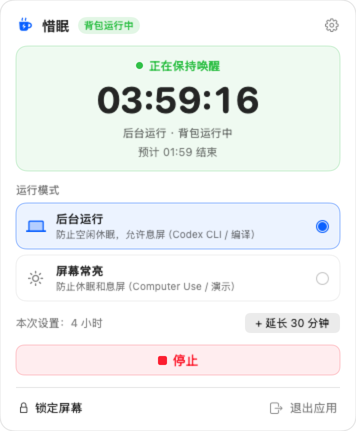
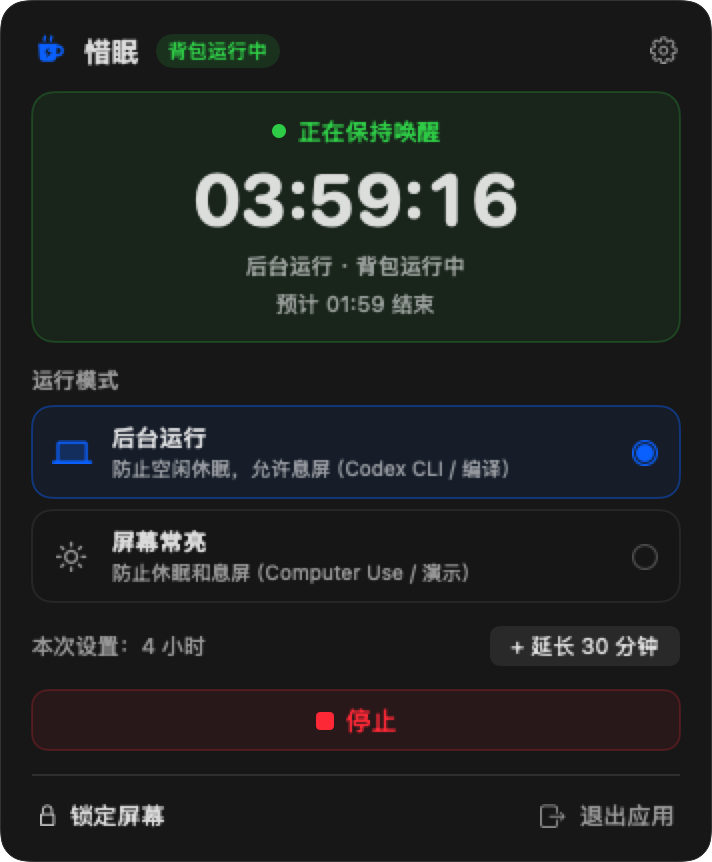
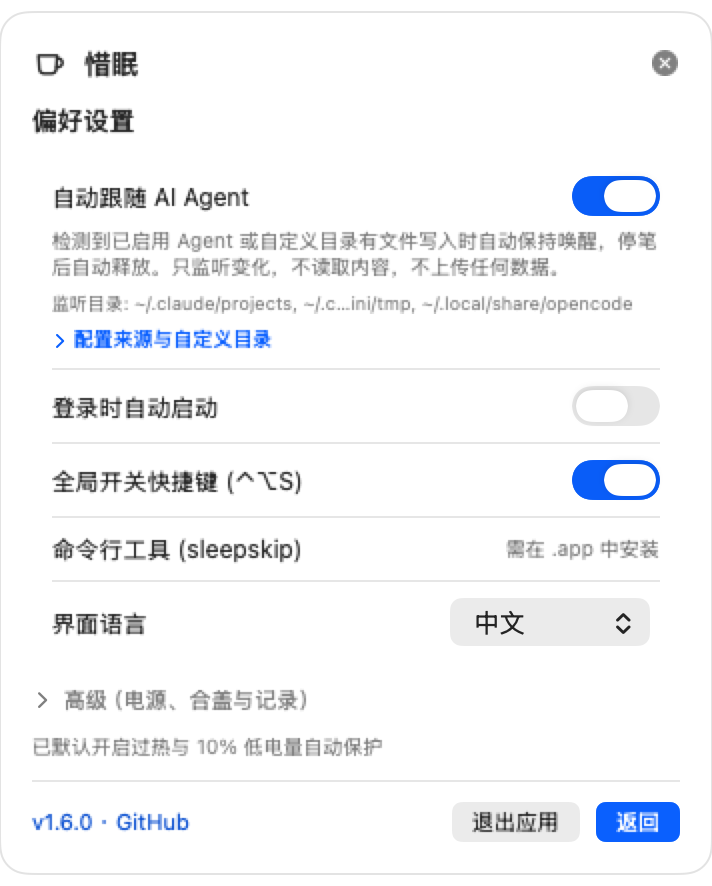

# SleepSkip（惜眠）

**围绕 Agent 工作流，让 Mac 保持唤醒。**

原生 macOS 菜单栏 + CLI 防休眠工具。目录跟随以 Claude Code、Codex、Gemini CLI、OpenCode、DeepSeek Harness 的近期会话写入作为活动信号；也可通过显式 Hook 或包裹命令管理任务生命周期。

[English](README.md) · [更新日志](CHANGELOG.md) · [产品需求文档 (PRD)](docs/PRD.md) · [实测资源占用](docs/PERFORMANCE.md) · [贡献指南](CONTRIBUTING.md)

## 30 秒快速上手

```bash
# 通过 Homebrew 一键安装 SleepSkip.app 与 sleepskip CLI
brew install --cask laiyongqiang/tap/sleepskip

# 或者直接包裹终端 Agent / 编译命令
sleepskip -- codex "refactor auth module"
```

在菜单栏打开 SleepSkip 按一次 `Enter` 即可直启，或保持默认的 **自动跟随 Agent** 让工具在 Agent 写文件期间自动接管。（从 Release 手动下载时，也可在 **偏好设置** 中一键安装 `sleepskip` CLI 命令。）

目录跟随采用启发式判断：每次写入记为 30 秒活动，再保留 5 分钟宽限期（检测到关联 Agent 子进程仍在运行时会自动顺延）；每轮自动会话设有可配置的安全上限（默认 2 小时，可在偏好设置调整为 `2h`、`4h`、`8h`、`12h` 或`无限制`）。手动定时到期时若 Agent 仍在活跃，也可自动接力切回自动跟随。对精确时长有明确要求且无写入信号的场景，建议使用命令包裹或手动会话。

[Beta 范围与验收清单](docs/BETA.md)记录验证边界、已知限制和恢复步骤。合盖模式仍属实验性功能，需要在具体硬件和 macOS 版本上验收。

---

## 界面预览

| 待机状态（浅色） | 运行中倒计时（浅色） | 运行中倒计时（深色） | 偏好设置 |
| :---: | :---: | :---: | :---: |
|  |  |  |  |

---

## 核心特色

- **自动跟随 AI Agent 与自定义目录**（默认开启）：单个 FSEvents 流监听内置 Agent 目录（Claude Code、Codex、Gemini CLI、OpenCode、DeepSeek Harness）以及用户在偏好设置中添加的自定义目录（支持逐个勾选开关），Agent 写文件期间按住睡眠，停笔 5 分钟后自动释放（关联子进程仍在运行时顺延宽限）。历史功耗数据及对应版本见[实测说明](docs/PERFORMANCE.md)。进程轮询方案实测为每 30 秒 160 毫秒外加每秒一次唤醒，已否决。只观察文件变化，从不读取会话内容。手动会话始终优先（支持从自动跟随一键转为手动定时、手动到期后自动接力跟随以及一键切回自动跟随），另有可配置安全上限（默认 2 小时）防止意外整夜挂机；运行中点击「停止本次跟随」仅结束当前会话并在下次静默后自动重新待命，偏好设置里的总开关保持不变。
- **事件驱动监听、仅在面板可见时刷新倒计时**：直接基于 macOS 原生 `/usr/bin/caffeinate`，倒计时定时器仅在 Popover 展开可见时运行；目录跟随使用一次性的活动截止调度，实验性标准合盖模式在运行期间另有每 5 秒一次的重置定时器。[实测](docs/PERFORMANCE.md)：空闲 120 秒仅消耗 0.09–0.24 毫秒 CPU——和一个只画菜单栏图标、什么都不做的 App 处于同一量级。
- **绑定断言生命周期**：GUI 和 CLI 的 `caffeinate` 通过 `-w <PID>` 绑定所属 SleepSkip 进程，正常结束或取消会释放；兼容合盖模式还依赖独立的 sentinel 和恢复脚本。
- **事件驱动全局快捷键 (`⌃⌥S`) + 记忆直启**：通过系统原生 Carbon `RegisterEventHotKey` 注册全局开关快捷键 `⌃⌥S`（无需辅助功能隐私授权、没有快捷键轮询，可在偏好设置开关）；也可打开面板按一次 `Enter` 立即按上次配置启动。
- **CLI 伴侣与精准 Hook（`sleepskip -- <cmd>` / `status` / `hook`）**：包裹终端命令并保留终端输入和子命令退出状态；支持读取运行中菜单栏应用状态的 `sleepskip status --json`（仅在状态跃迁时写快照、零常驻监听）与 `sleepskip stop` / `toggle` / `lock` 终端直控；还可接入 `sleepskip hook start|stop`（兼容 Claude Code `UserPromptSubmit` / `Stop` Hooks），实现「提问即防睡、答完即释放」，免等 5 分钟静默期。
- **URL Scheme 快捷联动**：支持 `sleepskip://start` / `stop` / `toggle` / `lock`，轻松接入 Raycast、Alfred 与 macOS 快捷指令。
- **两种纯正运行模式**：
  - **后台运行**（`caffeinate -i`，默认）：阻止系统空闲睡眠、允许屏幕熄灭省电。支持记忆开关「启动即锁屏」与可选「合盖继续运行（实验性）」。
  - **屏幕常亮**（`caffeinate -di`）：保持系统与桌面窗口渲染活跃，适合 **Computer Use 桌面操控**、投屏演示与日志监看。GUI 自动化仍需要已解锁的桌面会话，这个模式不会绕过系统锁屏和安全策略。（*跑 Computer Use 时建议手动把屏幕亮度调至最低以兼顾省电*）
- **两种可选的「合盖模式」（实验性）**（默认关闭、显式勾选启用）：
  - **标准模式（默认，无需授权）**：基于公开 SDK `kPMSetClamshellSleepState` 、事件驱动电源监听和每 5 秒一次的标志重置，无需管理员弹窗；已知系统限制为合盖状态下插回电源会在 6–9 秒后进入睡眠（详见 [合盖机制研究](docs/CLAMSHELL-RESEARCH.md)）。
  - **兼容模式（可在偏好设置中切换）**：经系统 Touch ID / 管理员授权执行 `pmset -a disablesleep 1`，配合内核 `kqueue` + `trap` 守护机制，支持跨电源切换保持，并在停止、超时或应用退出时自动恢复 `disablesleep 0`。
- **零轮询电源与自动温控安全网**：
  - **电量与拔电保护**：基于 `IOKit.ps` `IOPSNotificationCreateRunLoopSource` 事件回调，内置默认 `10%` 低电量自动停止保护（可在偏好设置中调整阈值或开启「拔掉电源时自动停止」）。
  - **GUI 会话的高温截止**：纯事件监听 `ProcessInfo.thermalStateDidChangeNotification`，当设备达到严重过热（`Critical`）时自动释放防休眠并发送原生通知，不进行周期性温度轮询。它释放 SleepSkip 的防休眠保护，不会终止 Agent 任务，也不能保证设备立即降温；运行时仍应保持通风。
- **极简图标、`sleepskip doctor` 与最近记录**：采用独立绘制的唤醒咖啡杯模版图标避免与系统「专注模式」撞脸；设置页保持清晰扁平布局，可直接查看`最近守护记录`；系统断言诊断可通过 `sleepskip doctor` 在终端按需检查，平时零功耗、界面零噪音。

---

## CLI 伴侣与 URL 自动化

通过 Homebrew 安装后即已就绪；或在 **偏好设置** 中一键点击 **安装 `sleepskip` CLI**（自动链接至 `/opt/homebrew/bin` 或 `/usr/local/bin`），也可手动建立软链接：

```bash
sudo ln -sf /Applications/SleepSkip.app/Contents/MacOS/SleepSkip /usr/local/bin/sleepskip
```

常用命令：

```bash
# 让 Mac 在 Codex 运行期间保持唤醒，结束后自动恢复正常休眠
sleepskip -- codex "refactor auth module"

# 运行 Computer Use 任务期间保持屏幕常亮，结束后立即锁屏
sleepskip --display --lock -- python agent.py

# 跟随已在运行中的进程 PID
sleepskip watch 12345 --lock

# 供脚本 / tmux / Starship 读取当前状态、健康自检或遥控（零后台轮询开销）
sleepskip status --json
sleepskip doctor
sleepskip toggle
sleepskip stop

# 一键安全读写 ~/.claude/settings.json（也可在偏好设置内一键点击连接）
sleepskip hook install
sleepskip hook uninstall

# 手动发送时提供相同会话 ID；安装后的 Claude Hook 自动读取 stdin JSON 的 session_id
sleepskip hook start --agent claude-code --session my-task
sleepskip hook stop --agent claude-code --session my-task
```

URL Scheme（适用 Raycast / Alfred / 快捷指令）：
- `sleepskip://start?mode=background&minutes=240&lock=1`
- `sleepskip://start?mode=display&minutes=60&lock=0`
- `sleepskip://stop`
- `sleepskip://toggle`
- `sleepskip://lock`

---

## 实测资源占用

以下为 1.2.0 历史样本；当前候选可用 `swift scripts/bench_idle.swift "$(pgrep -x SleepSkip)" 120` 复现；完整的测量方法与被否决的方案见 [docs/PERFORMANCE.md](docs/PERFORMANCE.md)。

| 状态 | 每 120 秒 CPU | 强制唤醒 |
| :--- | ---: | ---: |
| 空闲、面板收起 | 0.09–0.24 毫秒 | 3–11 次 |
| 自动跟随开启、Agent 正在写入 | 180 秒 0.73 毫秒 | 12 次 |
| 面板打开（1Hz 倒计时） | 60 秒 1.3 毫秒 | 约 60 次 |

这些是 1.2.0 的历史样本，不能代表当前全部运行模式。同期空菜单栏 App 的基线为每 120 秒 0.035–0.142 毫秒。普通待机不轮询进程或电源命令；标准合盖模式运行时另有每 5 秒一次的重置定时器，需要单独测量。

CI 与发版流程均已接入自动化待机功耗门禁（`./scripts/bench_gate.sh`），收起面板空闲 20 秒内若 CPU 超过 `15.0 ms` 或强制唤醒超过 `25` 次将直接阻断发版。

---

## 安装与从源码构建（macOS 13+）

### Homebrew 一键安装（推荐：同时安装 App 与 `sleepskip` CLI）

```bash
brew install --cask laiyongqiang/tap/sleepskip
```

Homebrew 会把 `SleepSkip.app` 装进 `/Applications`，并链接好 `sleepskip` 命令。命令名用 `sleepskip` 而不是 `skip`，是因为 Homebrew 里的 `skip` 已经被 skip.tools 占用。


### 下载 Release（通用二进制：Apple Silicon + Intel）

1. 前往 [GitHub Releases](https://github.com/LaiYongqiang/SleepSkip/releases) 下载最新的 `SleepSkip-*-macOS-universal.dmg`，拖入 `/Applications`。
2. 当前开源发行包采用本地 Ad-hoc 签名；若首次双击遇 macOS Gatekeeper 拦截，在终端执行一次：
   ```bash
   xattr -cr /Applications/SleepSkip.app
   ```

### 从源码构建

仅需安装 Xcode Command Line Tools（Swift 5.10+），无需完整 Xcode：

```bash
git clone https://github.com/LaiYongqiang/SleepSkip.git
cd SleepSkip

# 运行状态机单测与 caffeinate -w 生命周期测试
./scripts/verify.sh

# 构建 Universal (arm64+x86_64) SleepSkip.app、ZIP 与 DMG（输出到 ./dist/）
chmod +x scripts/build_app.sh
./scripts/build_app.sh
```

---

## 架构红线

1. 严禁无用途的周期唤醒、面板不可见时每秒重绘状态栏，以及周期性 `ps`/`pmset` 轮询；标准合盖的重置定时器须限定于有效合盖会话并单独测量。
2. 严禁静默或无自动恢复兜底地修改系统电源配置。
3. 严禁使用模拟鼠标微动/虚拟按键绕过系统锁屏安全机制。
4. 严禁调用 `killall caffeinate` 误杀其他应用断言。
5. 严禁引入 Electron、WebView 或重型后台常驻服务。

---

## 开源协议

[MIT License](LICENSE) © 2026 LaiYongqiang
